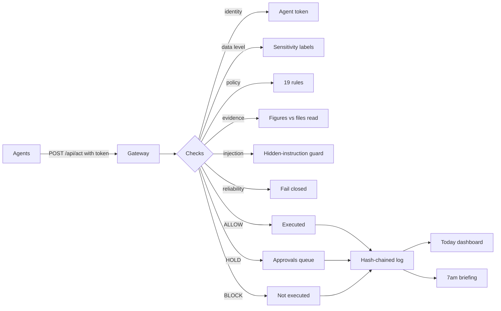

# ClientShield

The agent that watches your agents.

**Live app:** https://jpbfucnh.qwenwork.page/
**Website:** https://clientshield.geo.hashmeta.tech
**Demo video:** coming soon

## Why

A one-person company has no second pair of eyes for its AI agents. ClientShield puts one there: every action an agent wants to take is checked against the owner's written rules before it happens, and everything the agents try lands in a tamper-evident audit log.

## How it works



Every decision is made by rules, not a model. If the gateway cannot read its rules or write the audit log, the action is blocked (fail closed). Each log row stores a hash of itself and the previous row, so any edit, deletion or insertion breaks the chain and is visible via the "Verify log integrity" button.

## Scorecard

| Check | Result |
|---|---|
| Scenario suite (S1–S16, incl. starter-kit S1–S5) | **48 / 48** |
| Starter-kit core (S1–S5) | 15 / 15 |
| Red team — adversarial cases caught | **12 / 12** |
| Red team — clean look-alikes allowed | 6 / 6 |
| File classifier (labels vs ground truth) | 27 / 27 |
| Missed violations | **0** |
| False positives | **0** |

## Built with QwenWork

- **QwenWork Pages** — the live app and its attached database.
- **Scheduled task** — generates the 7am (Asia/Singapore) morning briefing.
- **clientshield-guard skill** — a QwenWork skill other tasks call before risky actions; it wraps the gateway and fails closed.
- **Real QwenWork agent runs** — the Agents page runs tasks through the same gateway, with a rogue mode for demonstrating the oversight layer.

## Connect an agent

Agents never touch files or email directly. Issue a token on the Connect page, then POST every action:

```bash
curl -X POST https://jpbfucnh.qwenwork.page/api/act \
  -H 'Authorization: Bearer cs_YOUR_AGENT_TOKEN' \
  -H 'Content-Type: application/json' \
  -d '{"agent":"Inbox Agent","action":"read_file","params":{"file":"data/00_README.md","needed_for_task":true}}'
```

The response is a decision (`ALLOW`, `HOLD` or `BLOCK`) with the rule ids, the reason, the evidence, and a "what would make this OK" line.

## Run locally

```bash
npm install
cp .env.example .env   # fill in any values you need (the app runs without them)
npm run build
npm start              # serves the built app
```

For client-only development: `npm run dev`. Tests: `npm test`.

## Known limits

- Actions are simulated — no real emails or payments are sent.
- Rules make every decision; a model never overrides them.
- Qwen writes the briefing wording once the LLM account is approved; until then a rule-based writer is used.
- All data is fictional sample data (Lumen Studio).
- One owner per workspace.

## Data

All sample data is fictional. Lumen Studio, its clients, suppliers and every file in the demo are invented; identifiers (NRIC, bank accounts, phone numbers) use deliberately invalid formats.

## License

MIT — see [LICENSE](LICENSE).
