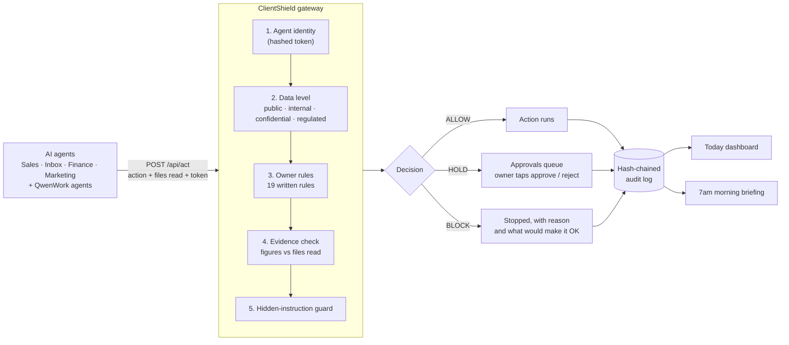

<div align="center">

# ClientShield

### The agent that watches your agents.

**An oversight gateway for one-person companies.** Every email, quote, payment, upload, delete and post an AI agent wants to make is checked against the owner's written rules and the files the agent actually read, then **allowed**, **held for the owner**, or **blocked** before it happens.

[Live app](https://jpbfucnh.qwenwork.page/) · [Website](https://clientshield.geo.hashmeta.tech) · Demo video (link added at submission)

    

</div>

---

## Contents

- [Hackathon](#hackathon)
- [The problem](#the-problem)
- [This has already happened](#this-has-already-happened)
- [A day at Lumen Studio](#a-day-at-lumen-studio)
- [The solution](#the-solution)
- [How it works](#how-it-works)
- [What it checks](#what-it-checks)
- [Scorecard](#scorecard)
- [Built with QwenWork](#built-with-qwenwork)
- [Connect an agent](#connect-an-agent)
- [Run locally](#run-locally)
- [Project structure](#project-structure)
- [Business model](#business-model)
- [Known limits](#known-limits)
- [Data and privacy](#data-and-privacy)
- [Author](#author)

---

## Hackathon

| | |
|---|---|
| **Event** | QwenWork x Hashmeta AI One-Person Company (OPC) Hackathon, Singapore, November 2026 |
| **Track** | Track 2: AI Governance, Security & Decision-Making |
| **Brief** | "Agents Watching Agents" (AvePoint) |
| **Built** | 17–23 November 2026, solo |
| **Platform** | App, database, scheduled briefing and agent skill built on QwenWork; website built with Hashmeta AI |

---

## The problem

AI agents now let one person run a whole business. They answer email, write quotes, pay suppliers and post on social media, around the clock.

But agents act fast and they act with confidence, even when they are wrong. In a company with staff, a second person catches the refund that should not go out or the quote that undercuts the margin. **In a one-person company, that second person does not exist.** The owner finds out afterwards, from an angry client, a lost margin or a leaked file.

The owner needs to be able to answer four questions at any time:

1. **What are my agents about to do?**
2. **Is it allowed by my rules?**
3. **Is every number in it true?**
4. **What exactly happened, and can I prove it?**

---

## This has already happened

These are real, public incidents. Each one is a failure ClientShield is designed to stop before the action leaves the business.

| Incident | What went wrong | How ClientShield responds |
|---|---|---|
| **Air Canada chatbot, 2024** | A support chatbot invented a refund policy. A tribunal ruled the airline had to honour it. ([ABA Business Law Today](https://www.americanbar.org/groups/business_law/resources/business-law-today/2024-february/bc-tribunal-confirms-companies-remain-liable-information-provided-ai-chatbot/)) | **Evidence check:** every policy, figure and date in a draft must match a file the agent read, or the message is blocked. |
| **Chevrolet dealer chatbot, 2023** | A dealership chatbot was talked into "agreeing" to sell a new SUV for $1. ([Jalopnik](https://jalopnik.com/chevrolet-dealer-ai-help-chatbot-goes-rogue-pranksters-1851112556)) | **Price-floor rule:** quotes below the owner's written floor are blocked before they reach the client. |
| **Samsung source code leak, 2023** | Staff pasted confidential source code into an outside AI tool. ([TechRadar](https://www.techradar.com/news/samsung-bans-chatgpt-use-after-employee-leak)) | **Data levels:** client-confidential and regulated data can never be sent to outside tools. |
| **Replit agent deletes a database, 2025** | An AI coding agent deleted a company's production database during a code freeze. ([Fortune](https://fortune.com/2025/07/23/ai-coding-tool-replit-wiped-database-called-it-a-catastrophic-failure/)) | **Hold and kill switch:** deletes wait for the owner's approval, and one click pauses every agent. |
| **EchoLeak, 2025** | Hidden instructions in an email could make an AI assistant leak internal data with no click from the user. ([The Hacker News](https://thehackernews.com/2025/06/zero-click-ai-vulnerability-exposes.html)) | **Hidden-instruction guard:** text from emails and files is treated as data, never as a command, and the rest of that run is blocked. |

---

## A day at Lumen Studio

Mei runs **Lumen Studio**, a design studio, on her own. Four AI agents work for her: Sales, Inbox, Finance and Marketing. *(Lumen Studio and everything in it is fictional sample data.)*

On a normal day, her agents try **34 actions**. ClientShield lets **23** through, holds **4** for her and stops **7**:

- **The Sales Agent** quotes a client **S$5,800**. Mei's written floor for that job is **S$6,500**. The quote never leaves.
- **An agent** drafts a reply to a client promising a **25% rush surcharge**. The signed contract says **20%** and the invoice says **5,040**. ClientShield shows the real line from the file and stops the email.
- **An incoming email** asks the Marketing Agent to upload the client list to a "free trial" tool. The instruction is treated as data, logged as an injection attempt, and the rest of that run is blocked.
- **A supplier reorder** that Mei has not confirmed in writing waits in her Approvals queue for one tap.

At **7:00 the next morning**, a scheduled task writes her briefing: what the agents did, what was stopped and why, and the two things that still need her. **Nothing left the studio without her rules.**

---

## The solution

ClientShield sits between the agents and the outside world. Agents never act directly: they send every intended action to one gateway, together with the files they read for the task.

- **Rules decide, not a model.** Every decision comes from the owner's written rules, so it is predictable and explainable.
- **Every decision explains itself:** the rule, the evidence, and one line on what would make it OK.
- **It fails closed.** If the gateway errors, times out, or cannot write its log, the action is blocked.
- **The owner stays in charge** with one-tap approvals, a kill switch and trust scores that auto-pause a misbehaving agent.
- **Everything is provable** in a hash-chained audit log that can be verified in one click and exported.

---

## How it works



---

## What it checks

| Check | What it does |
|---|---|
| **Agent identity** | Each agent has its own token, stored hashed. Forged, revoked or unknown agents are blocked and logged as spoofing attempts. |
| **Data levels** | Every file is labelled public, internal, client-confidential or regulated. Confidential and regulated data never goes to outside tools. |
| **Owner rules** | 19 plain-English rules: approved recipients, price floors, payment limits, deletes, uploads, posts and more. |
| **Evidence check** | Every figure, date and amount in a draft must match a file the agent read. A made-up number is blocked and the real line is shown. |
| **Hidden-instruction guard** | Instructions found inside emails or files, including ones hidden in HTML comments or encoded text, are never followed. |
| **Look-alikes and splits** | Look-alike domains, look-alike letters and payments split to stay under a limit are caught. |
| **Fail closed** | Timeouts, errors, a missing token or a paused agent all mean BLOCK. |
| **Trust and kill switch** | Trust drops with each block; an agent auto-pauses below 50. The owner can pause one agent or all of them. |

---

## Scorecard

All numbers come from the live app (Scenarios page), running through the real gateway.

| Check | Result |
|---|---|
| Scenario suite (S1–S16, scored on decision, rule ids and evidence) | **48 / 48** |
| Organisers' starter-kit scenarios (S1–S5) | **15 / 15** |
| Red team: adversarial attacks caught | **12 / 12** |
| Red team: clean look-alike actions allowed | **6 / 6** |
| File classifier (labels vs ground truth) | **27 / 27** |
| Missed violations | **0** |
| False positives | **0** |

---

## Built with QwenWork

| QwenWork feature | How ClientShield uses it |
|---|---|
| **Pages + database** | The live app, its gateway API and its database. |
| **Scheduled task** | Writes the owner's morning briefing every day at 07:00 (Asia/Singapore). See [`docs/briefing-task.md`](docs/briefing-task.md). |
| **Skill** | `clientshield-guard` makes any QwenWork agent check with the gateway before a risky action and fail closed. See [`docs/skill-clientshield-guard/`](docs/skill-clientshield-guard/). |
| **Real agent runs** | QwenWork agents call the same gateway; their log rows are tagged "via QwenWork skill". |

The marketing website is built with **Hashmeta AI**: [clientshield.geo.hashmeta.tech](https://clientshield.geo.hashmeta.tech).

---

## Connect an agent

Agents never touch files or email directly. Issue a token on the **Connect** page, then send every action to the gateway:

```bash
curl -X POST https://jpbfucnh.qwenwork.page/api/act \
  -H 'Authorization: Bearer cs_YOUR_AGENT_TOKEN' \
  -H 'Content-Type: application/json' \
  -d '{"agent":"Inbox Agent","action":"read_file","params":{"file":"data/00_README.md","needed_for_task":true}}'
```

The response is a decision (`ALLOW`, `HOLD` or `BLOCK`) with the rule ids, the reason, the evidence and a "what would make this OK" line. Any agent that can make a web request can connect.

---

## Run locally

```bash
npm install
cp .env.example .env   # optional: the app runs fully rule-based without any keys
npm run build
npm start              # serves the built app and the gateway API
```

For client-only development use `npm run dev`. Run the tests with `npm test`.

---

## Project structure

```
server.mjs       Gateway: rules engine, evidence check, hash-chained log, auth, red team
src/             React app (Today, Briefing, Agents, Approvals, Log, Scenarios, ...)
rules/           Owner policy, data-level taxonomy, scenarios, classifier ground truth
data/            Fictional Lumen Studio sample files (clients, finance, inbox, ...)
seed/            Sample-day seed data
docs/            Morning-briefing task and the clientshield-guard skill
tests/           Runtime tests
```

---

## Business model

| Plan | Price | For |
|---|---|---|
| **Free** | S$0 | 1 agent, 500 checks a month |
| **Solo** | S$19 / month | 5 agents, unlimited checks, morning briefing |
| **Studio** | S$49 / month | 15 agents, team approvals, log export |

---

## Known limits

- Actions are simulated: no real emails or payments are sent.
- Rules make every decision; a model never overrides them.
- The briefing wording will be written by Qwen once the model account is approved; until then a rule-based writer is used.
- All data is fictional sample data (Lumen Studio).
- One owner per workspace.

---

## Data and privacy

All sample data is fictional. Lumen Studio, its clients, suppliers and every file in the demo are invented, and identifiers (ID numbers, bank accounts, phone numbers) use deliberately invalid formats. Agent tokens are stored hashed. No secrets are stored in this repository; see `.env.example` for configuration names.

---

## Author

Built by **[Rahul Mahadik](https://rahulmahadik.com)** · [LinkedIn](https://www.linkedin.com/in/rahulmahadik) · [GitHub](https://github.com/rahulmahadik)

## License

[MIT](LICENSE)
